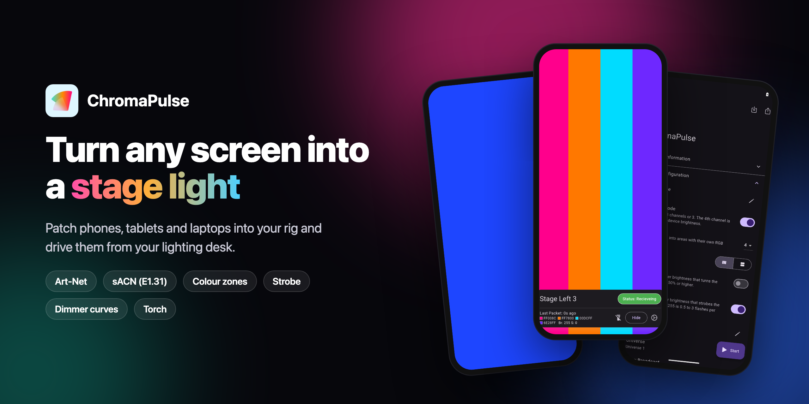
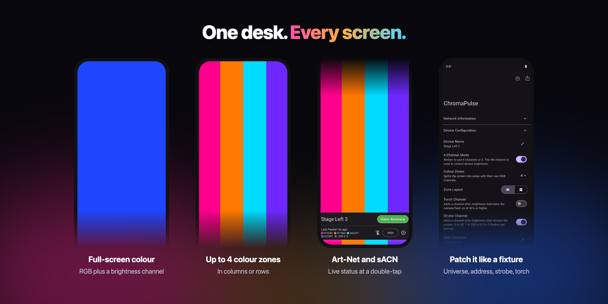
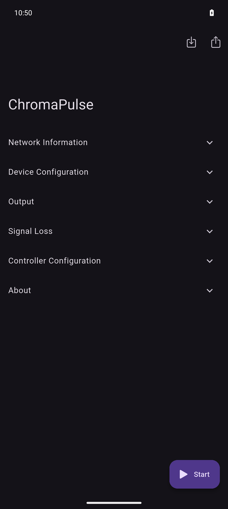
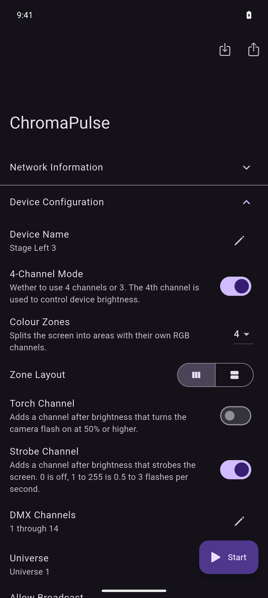
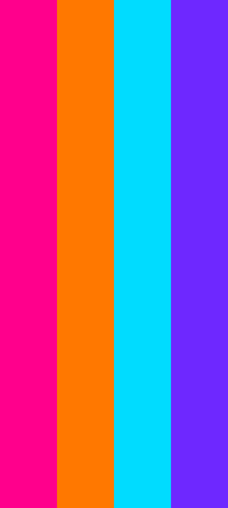
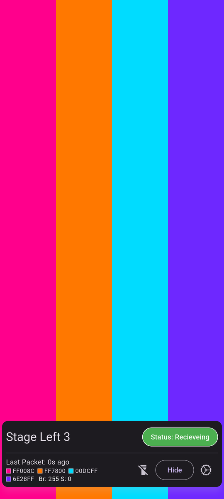

# ChromaPulse

With ChromaPulse, you can turn any display into a powerful and dynamic light source, opening up endless possibilities for lighting designers.

Designed for use in theaters and other performance venues, ChromaPulse allows you to control the color, intensity, and timing of your display lights with just a few taps on your device. Whether you're looking to create an immersive backdrop for your play or add dramatic accents to your musical performance, ChromaPulse makes it easy to achieve the perfect lighting effects.



## Features

- **Art-Net and sACN (E1.31).** Patch each device like a fixture with a universe and a start address, then drive it from any lighting desk.
- **Colour zones.** Split the screen into up to 4 zones, in columns or rows, each with its own RGB channels.
- **Brightness, dimmer curve and fade time.** An optional 4th channel sets screen brightness. Choose a linear or square-law curve, and fade between looks.
- **Strobe and torch channels.** Strobe the screen at up to 3 Hz, or switch the camera flash on from the desk.
- **Signal loss.** Hold the last look, black out, fade out, or show a set colour when the controller goes quiet.
- **Device names.** Each device shows its own name in ArtPollReply, so you can find it in your desk's patch.
- **Share a setup.** Export your configuration as a QR code and scan it on the next device.

## Screenshots

| Settings | Device configuration | Colour zones | Live status | Full-screen colour |
| :---: | :---: | :---: | :---: | :---: |
|  |  |  |  |  |

## Download

Join the beta on [TestFlight](https://testflight.apple.com/join/TifM2Pyl), or download the Android APK from the [latest release](https://github.com/aguilaair/chromapulse/releases/latest).

Download on the App Stores:

<div style="display:flex;flex-direction:row;justify-content:space-around;align-items:center;">
<a href="https://play.google.com/store/apps/details?id=dev.eduardom.chromapulse"></a>
<a href="https://apps.apple.com/us/app/chromapulse/6448711600"></a>
</div>

## Developing

This app is built with Flutter.

Build it with:

```bash
flutter pub get
flutter build appbundle
flutter build ios
```

To test without a lighting desk, send DMX from your computer with `tool/dmx_send.py`:

```bash
python3 tool/dmx_send.py artnet 192.168.1.20 255 0 0
python3 tool/dmx_send.py sacn multicast 0 255 0 --universe 2
```
